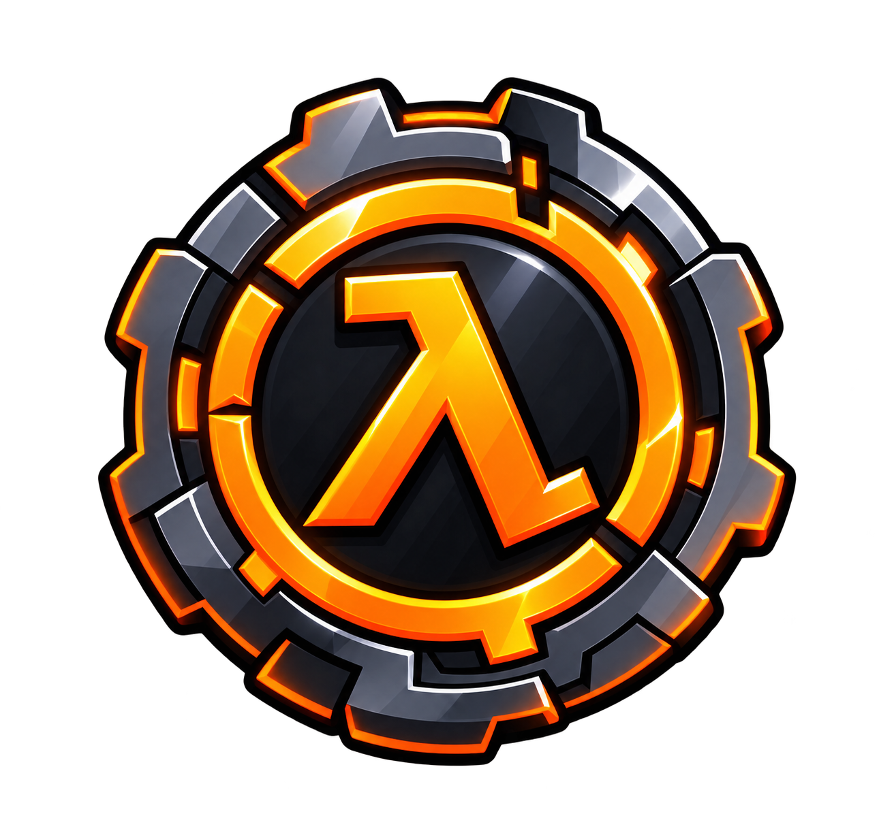

<p align="center">
  
</p>

<h1 align="center">
  <b>Vellum</b>
</h1>

<p align="center">
  GoldSrc loader and <code>steamclient</code> for the Raspad stack.
</p>

---

GoldSrc loader and `steamclient` for the Raspad stack. It stands in for Steam so Counter-Strike 1.6 (and other Half-Life 1 games) can run without the Steam client, RevEmu sidecars, or extra plugins.

Two targets, Windows and Linux:

| Target | Output | Role |
|---|---|---|
| **loader** | `cstrike.exe` / `cstrike_linux` | Pretend to be Steam, then start the engine |
| **steamclient** | `steamclient.dll` / `steamclient.so` | Steamworks facades the engine actually calls |

No `rev.ini`, no `steam.dll`, no MetaHook/MetaVoice/MetaAudio. Copy the two binaries next to `hl.exe` / `hl_linux` and run the loader.

The engine, filesystem, and `hw` live in [raspad-hl](https://github.com/darwin128k/raspad-hl). Vellum either spawns that `hl` binary (default loader mode) or compiles `src/launcher.cpp` from `HL_DIR` into this process (standalone).

## Editions

The loader is built once per game. Every edition is the same source with a
different name, game directory, Steam AppId, icon and instance mutex:

| Edition | Wrapper | Starts | Steam AppId | Build dir |
|---|---|---|---|---|
| Counter-Strike 1.6 | `cstrike.exe` | `hl.exe -game cstrike` | 10 | `build\` |
| Sven Co-op | `svencoop.exe` | `hl.exe -game svencoop` | 225840 | `build-svencoop\` |

An edition owns its game: it does **not** accept a `-game` from the caller —
a `-game` on the command line is dropped, so the wrapper can never be talked
into starting a different game. Everything else is passed through to the
engine (`-connect`, `-console`, map names, …).

Two shapes per edition:

- **wrapper** (default) — spawns `hl.exe -game <game>`; needs `hl.exe` next to it.
- **standalone** (`build.bat standalone`) — compiles the `hl` launcher into the
  wrapper, so the game runs in one process and no `hl.exe` is needed.

Add a new edition by adding a line to `build.bat` (name, game directory, AppId)
and dropping `res/<name>.rc` + `res/<name>.ico` next to the cstrike ones.

## What steamclient implements

- **SteamClient012 / 017 / 020** — enough of `CreateInterface` for GoldSrc 8684 and Steam Half-Life (Oct 2024 / 10210+).
- **Auth** — 120-byte Vellum v2 ticket (`VLLM`), Ed25519-signed for the server address the engine dials and the local clock; checked by [qproto](https://github.com/darwin128k/raspad-qproto) 2.x. Optional RevEmu 2013 tickets are available with `build.bat revemu2013` / `./build.sh revemu2013` or CMake `-DVELLUM_AUTH_REVEMU2013=ON`. Vellum v2 remains the default; one outgoing dialect is selected per build. Ed25519 comes from [Authum](https://github.com/darwin128k/raspad-authum) (`lib/authum` submodule, vendored Monocypher).
- **RevEmu 2013 identity** uses the legacy Windows C: volume serial / Linux machine-id, without the Vellum profile key. Build without `revemu2013` to return to Vellum v2.
- **Identity** — persona is the OS user name. The SteamID comes from a key pair created on first run and kept in the user profile (Windows: `%APPDATA%\Raspad\vellum.key`; Linux: `$XDG_DATA_HOME/raspad/vellum.key` or `~/.local/share/raspad/vellum.key`, mode 0600). Never in the game folder — copy that key and you copy the SteamID. Nothing about the machine (hostname, disk serial) is sent.
- **Server browser** — favorites/history via `config/serverbrowser.vdf`. The Internet list comes from the masters named in `config/vellum.cfg`; with no master configured the tab stays empty. LAN is UDP broadcast. Game/map/ping are filled with A2S.
- **HTTP** — real `ISteamHTTP` for FastDL and list fetches (WinINet on Windows, libcurl on Linux).
- **Voice** — `ISteamUser` capture/encode/decode. Microphone opens only while `+voicerecord` is held. Packets are Steam Voice Opus (24 kHz), so other Vellum/Steam-format clients can hear you. No extra voice plugin.

## Config

Written next to the game / `steamclient` binary.

**`config/serverbrowser.vdf`** — favorites and history, same layout as stock GoldSrc. The Internet tab does not read a VDF.

**`config/vellum.cfg`** — runtime settings of the facade:

```
# 0 = do not query masters at all (Internet tab stays empty).
# Favorites and LAN keep working. Default is 1.
internet = 1

# Masters to query for the Internet server list, comma separated.
# Empty (or no file at all) = no master is queried.
masters = 10.0.0.5:27010, 10.0.0.6:27010
```

No master is baked into the binary: every deployment names its own. To
disable the Internet list without a config file, compile with
`-DVELLUM_NO_SERVER_BROWSER=ON` or `build.bat nobrowser`.

## Download automatic builds

GitHub Actions **Build downloads** runs on pushes, pull requests, and manual dispatch.
Open a successful run under **Actions**, then download its **Artifacts**. There are
four artifact bundles: Windows/Linux x86, each with Vellum v2 or RevEmu 2013 auth.
Each bundle contains separate archives for Counter-Strike 1.6 and Sven Co-op plus
SHA-256 checksums. Windows downloads are ZIP; Linux downloads are tar.gz.

Archives include the game wrapper, `hl.exe` / `hl_linux`, steamclient, instructions, licenses, and
`config/vellum.cfg.example`. Existing configs are preserved. Game data and engine libraries (`hw`, filesystem, etc.)
are required separately. Select one auth variant per installation; auth is chosen
at build time. Vellum v2 is the default for local builds.

Linux builds target Debian 12 x86 (glibc 2.36+). Runtime packages:
`libopus0:i386`, `libasound2:i386`, and `libcurl4:i386` for HTTP.
Windows builds use the static MSVC runtime.

CI fetches `darwin128k/raspad-hl` (`master` by default) and builds its launcher through
`HL_DIR`. Publish its Linux port before enabling these builds. Manual runs can select
`hl_ref` (branch, tag, or commit). Local CI-equivalent builds use
`python tools/ci_build.py --platform windows --auth vellum --hl-dir ../raspad-hl`
(or `python3 ... --platform linux`). These are wrapper builds; standalone remains
available separately through the existing build scripts.

Pushing a tag beginning with `v` also creates a GitHub Release (or updates its assets)
with all eight game/platform/auth archives and their checksums. Branch/PR builds
stay in Actions and expire after 30 days. The workflow does not create tags.

## Build

32-bit only, to match `hw` and `steam_api`.

Fetch the Authum submodule first (Ed25519 for Vellum tickets; nested
submodules are not needed):

```sh
git submodule update --init lib/authum
```

### Windows

Needs:

- Visual Studio 2022 with the **Desktop development with C++** workload and the **MSVC x86** toolset (`vcvars32.bat` — `build.bat` looks under Enterprise by default)
- [CMake](https://cmake.org/) 3.16+
- [Ninja](https://ninja-build.org/) on `PATH`
- Git (CMake FetchContent clones Opus)

Opus is fetched and linked statically. WinINet / WinMM come with the Windows SDK.

```bat
build.bat
build.bat debug
build.bat nobrowser
```

Standalone (optional `HL_DIR`, default `..\raspad-hl` or `..\hl`):

```bat
build.bat standalone
build.bat standalone D:\src\raspad-hl
```

Output: `build\cstrike.exe`, `build\steamclient.dll` and
`build-svencoop\svencoop.exe`, `build-svencoop\steamclient.dll`. Copy the
loader and the `steamclient` of your game into the game folder.

### Linux / WSL

Needs a 32-bit toolchain plus **Opus** and **libasound2** (ALSA) for voice. On Ubuntu/Debian (including WSL):

```sh
sudo dpkg --add-architecture i386
sudo apt update
sudo apt install cmake g++ gcc-multilib g++-multilib \
    libopus-dev:i386 libasound2-dev:i386
```

| Package | For |
|---|---|
| cmake, g++, gcc-multilib, g++-multilib | 32-bit C++ (`-m32`) |
| **libopus-dev:i386** | Opus (`<opus/opus.h>`, `libopus`) |
| **libasound2-dev:i386** | ALSA / libasound2 (`alsa/asoundlib.h`) |

To **run** the game you also need **libcurl4:i386** (`libcurl.so.4`). steamclient loads it with `dlopen`, so the binary still starts without it — but HTTP FastDL does nothing. Connect, voice, LAN, and the UDP master keep working. Curl is not required to compile.

```sh
sudo apt install libcurl4:i386
```

```sh
./build.sh
./build.sh nobrowser
./build.sh standalone
./build.sh standalone ../raspad-hl
```

Output: `build-linux/cstrike_linux`, `build-linux/steamclient.so`. Copy both next to `hw.so`. Loader mode also needs `hl` in that folder.

## Run

Windows:

```bat
cstrike.exe
```

Linux:

```sh
chmod +x cstrike_linux
./cstrike_linux
```

One loader instance at a time. Optional `-launch` / `-appid`. Default game is `cstrike`.

Release builds write no `vellum.log`. Debug (`build.bat debug`) logs a timestamped session: identity, interfaces, connect ticket, master list, and voice tx/rx.

## Versions

One branch: `master`. Lineage is tags, not forks.

| Tag | What it is |
|---|---|
| **v1.0.0** | Last RevLoader/Vellum line before Ed25519 tickets (baked-in masters still existed in that era) |
| **v2.0.0** | Vellum v2 tickets, profile key, per-game wrappers (CS 1.6 + Sven Co-op), masters only from config |

v2 is what Sven Co-op was checked against. Checkout the tag if you need that snapshot; keep building from `master`.

## Build options

| CMake / `build.bat` | Effect |
|---|---|
| `VELLUM_NAME` / `VELLUM_GAME` / `VELLUM_APPID` | Wrapper edition (cstrike, svencoop, …) |
| `VELLUM_STANDALONE` / `build.bat standalone` | Compile `hl` launcher into the wrapper |
| `HL_METAHHOOK` / `build.bat metahook` | Embed MetaHookSv (Windows standalone only) |
| `VELLUM_AUTH_REVEMU2013` / `build.bat revemu2013` | Use RevEmu 2013 authentication (default OFF, Vellum v2) |
| `VELLUM_NO_SERVER_BROWSER` / `build.bat nobrowser` | Compile out Internet master queries |

CMake `-DVELLUM_NO_SERVER_BROWSER=ON` compiles the Internet query out entirely. Default is **OFF**. Favorites and LAN are unaffected. Runtime `internet = 0` in `vellum.cfg` does the same without a rebuild.

## Auth smoke test

After configuring either auth mode, run `cmake --build <build-dir> --target auth_ticket_smoke`,
then run `<build-dir>/auth_ticket_smoke` (`.exe` on Windows). It checks buffer limits,
ticket size, and SteamID consistency; Vellum v2 also checks the signature and rejects
a changed server address. Run it once with `VELLUM_AUTH_REVEMU2013=OFF` and once with `ON`.
The Vellum test loads or creates the current user's profile key, like the client.

`cmake --build <build-dir> --target loader_args_smoke` checks argument round trips
through the Windows command-line parser or Linux shell parser, including spaces,
quotes, empty values, and shell metacharacters. Run the resulting executable.
Both smoke tests run before CI packages any downloads.

## License

MIT. See [LICENSE](LICENSE).

Windows builds vendor [Opus](https://github.com/xiph/opus) (BSD-style) through CMake FetchContent. Linux builds against the distro Opus package.

`steamclient` compiles [Monocypher](https://monocypher.org/) 4.0.2 from the Authum submodule (`lib/authum/lib/monocypher`), Copyright (c) 2017-2023 Loup Vaillant, Michael Savage, Fabio Scotoni — BSD-2-Clause / CC0-1.0, see `lib/authum/lib/monocypher/LICENCE.md`.
